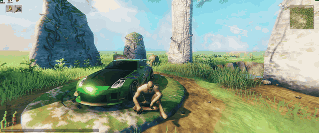
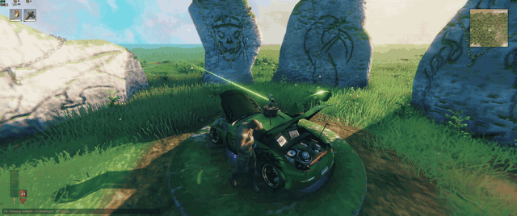
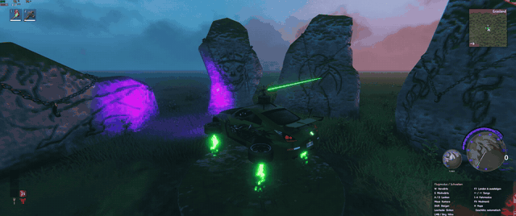
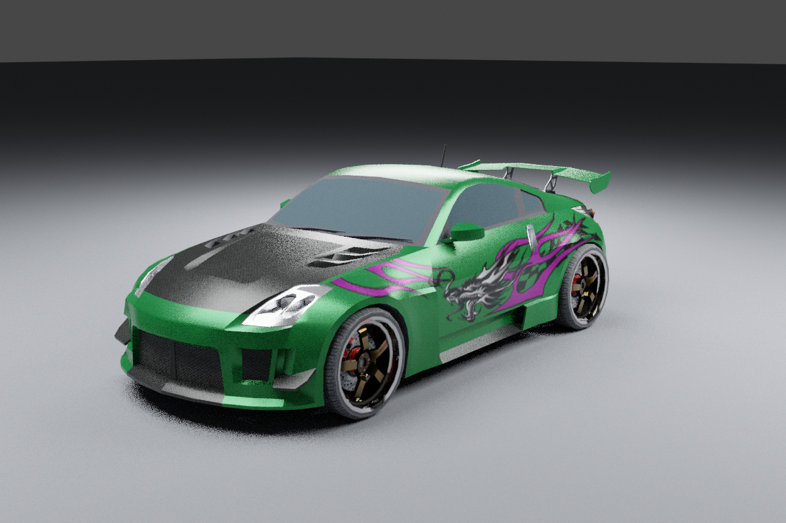
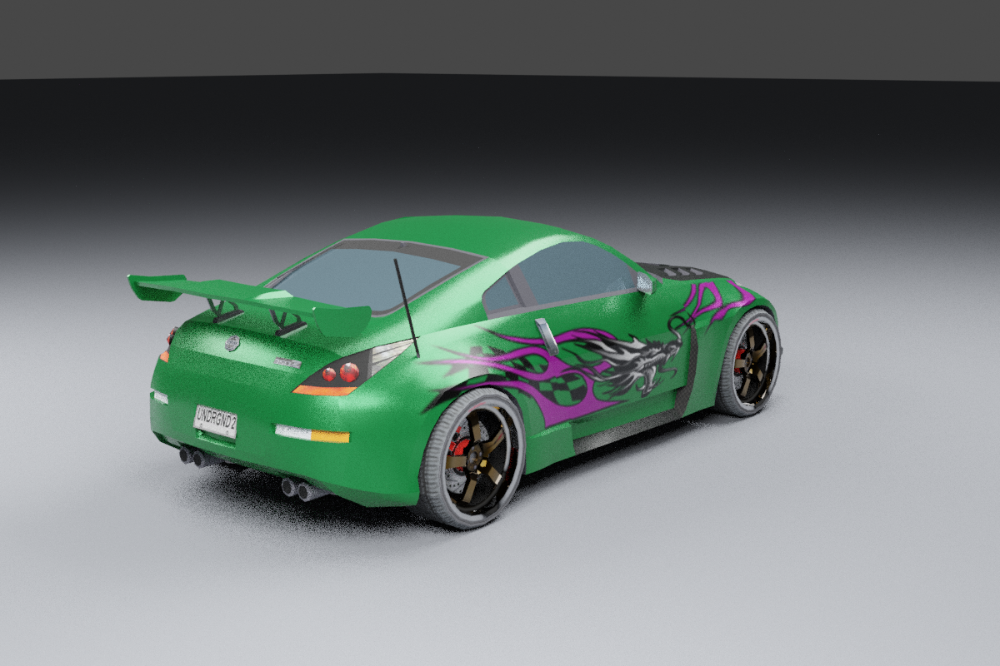

Drive a Nissan 350Z through Valheim. Drift through the meadows, hit the nitro,
or take off and fly. Viking transportation got a little out of hand.

*Is it random? — Yes. Is it useful? — Not really. Did I make it anyway? — Kinda. Codex did all of it.*

### What you get

- Nissan 350Z and Hummer H2, with road, off-road and flight modes; drift mode for the 350Z.
- Keyboard & mouse and controller support, with Xbox / PlayStation button hints.
- Nitro, neon, wheel tuning, exhaust options and an in-game customization menu.
- Vehicle sounds, radio, and a roof turret for the 350Z.
- 350Z horde mode with minimap radar, god pacts, elemental ammunition and a dragon finale.
- Cargo storage, with less room as the 350Z audio enclosure grows; fixed storage for the H2.
- English and German menus.

### Install & drive

Windows 10/11, 64-bit. **Single-player only**; cars are temporary and are not saved with the world.

**[Download the Windows installer (148 MB)](https://github.com/Backwoodz/NFVU2/releases/download/v0.28.0/NFVU2-Setup-0.28.0-r6.exe)**

1. Download the installer above, or get **NFVU2-Setup-*.exe** from [Releases](https://github.com/Backwoodz/NFVU2/releases).
   Use the installer asset, not GitHub's “Source code” download.
2. Close Valheim, run the installer and select **valheim.exe**.
   In Steam: Valheim → Manage → Browse local files.
3. Click **Install / Update**. Music is included; BepInEx is installed if needed.
4. Launch Valheim normally, enter a single-player world and press **F9**
   (controller: **L3**) → **Garage** to spawn a car.

**F7** / **B (Xbox)** / **Circle (PlayStation)** enters or exits nearby cars.
Use **WASD** or the **left stick + triggers** to drive. On-screen hints show the rest.
Choose English under **F9 → Einstellungen → Sprache** if needed.

**Remove a car:** sit inside or stand within 5 m, then **F9 / L3 → Vehicle → Remove vehicle**
(German: **Fahrzeug → Fahrzeug entfernen**). Confirm with **A / Cross** on a controller.

**Update:** run the newer installer and choose the same game.
**Uninstall:** run the installer again, select the game and click **Uninstall**.
Settings, saves and other mods are kept. You can also remove BepInEx if this
wizard installed it and no other mods need it.

### Vehicle storage

Park, exit and walk to the rear of the car, then choose **F9 → Vehicle → Open storage**
(controller: **L3**, then select the button). This opens Valheim's normal chest inventory,
including drag/drop, splitting, stacking and take-all. The menu shows occupied/total slots.
Each spawned car has its own cargo. Storage is unavailable while driving or flying.

| Vehicle / trunk enclosure | Item slots |
| --- | ---: |
| 350Z stock, no audio enclosure | 24 (6 × 4) |
| 350Z stage 1, two equipment mounts | 18 (6 × 3) |
| 350Z stage 2, four equipment mounts | 12 (6 × 2) |
| 350Z stage 3, six equipment mounts | 6 (6 × 1) |
| Hummer H2 | 32 (8 × 4) |

For comparison, the installed vanilla prefabs have 10 slots in a wooden chest,
24 in a reinforced chest and 32 in a black metal chest. Each slot accepts the
item's normal stack size. The enclosure determines capacity, including covered
audio mounts; changing speaker brands does not change storage. The existing
default audio setup is stage 2, so it starts with 12 slots.

Before selecting an enclosure with less storage, remove excess item stacks and
close the inventory. The check includes every spawned 350Z because enclosure
settings are shared. Items are repacked without discarding or merging stacks.

**Cargo survives the temporary car:** removing a loaded vehicle or leaving the
world leaves its contents in a normal reinforced chest (350Z) or black metal
chest (H2) at its last location, on the ground beneath it if airborne. Retrieve
items from that chest after returning; a newly spawned car starts empty. Empty
loaded cargo containers are removed when the car is removed. Cargo uses the
world's normal save system and remains accessible without the mod; unsaved
changes have the same crash/rollback limitations as other Valheim chests.
Native inventory UI, zone travel and save/reload still require an in-game test.

### Vehicle horde mode

In single-player, sit in a **350Z with loaded turret assets**, land, then press
**Numpad 9** (Num Lock on) to start five waves:

1. 12 Greylings and 3 Greydwarfs (15).
2. 12 skeletons, 6 Greydwarfs and 2 Greydwarf brutes (20).
3. 10 Draugr, 6 wolves and 2 Greydwarf shamans (18).
4. 12 Fulings and 2 Fuling berserkers (14).
5. **Moder**, 2 flying drakes and 4 Fulings (7).

When seated in a ready, grounded 350Z, a hint beneath the minimap reads
**Face the horde / Numpad 9 · Begin the battle** (localized to German/English).
It follows the map's HUD position and disappears during a run, menus, the large
map, and after leaving the car.

Before each wave, choose one **pact of the gods**, or play without one.
Three random offers come from six pacts, with at least two different offers
from the previous wave. The selection opens immediately when a wave is cleared.
Valkyrie's Watch is excluded from wave 5; the temporary 15-second auto pickup remains available.
Use **1–4**, click a card, or select with the controller D-pad and confirm
with A/Cross. The car brakes and takes no horde damage during selection.

| Pact | Benefit | Drawback |
| --- | --- | --- |
| Odin's Haste | Reload takes 1.5 instead of 2.5 seconds | Enemies move 20% faster |
| Thor's Wrath | Explosive ammunition for the entire wave | Enemies have 35% more health |
| Iron Chariot | Double run-over damage | Turret bullets and enemy splash deal 25% less damage |
| Skadi's Winter | Ice ammunition briefly freezes ordinary enemies, tinting them white-blue | Reload takes 3 seconds; bosses are only slowed |
| Storm Chain | Lightning ammunition jumps to up to 3 nearby enemies | Direct bullets deal 20% less damage |
| Valkyrie's Watch | Automatic turret for the entire wave | Enemy attacks deal 25% more damage |

Pacts do not stack and expire after their wave. Thor still uses 30-round magazines
and normal reloads. During Thor, Skadi or Storm Chain waves, orange pickups become
shield pickups; Valkyrie replaces redundant auto pickups with repair pickups.
Ice freezes for 1.2 seconds, followed by 2.4 seconds of immunity to prevent permanent
freezing. Bosses retain their attacks and move 35% slower during the effect.
Lightning chains trigger at most every 0.4 seconds, jump up to 8 m through clear
lines of sight, and lose damage at each jump. They only chain between horde enemies.
Both ammunition types have colored tracers. Ice temporarily tints enemies;
lightning draws visible arcs without flashing enemy colors. These are wave buffs,
selected through the pact cards.
Each wave starts with a full magazine; powerups from the previous wave expire.
All encounter enemies share a faction so the mixed roster fights together.

The Hummer H2 cannot start this mode because it has no turret.

Living horde enemies appear as **small red dots on the minimap**. Dots follow
enemy movement and map zoom; off-screen enemies are hidden. They disappear on
death or when the run ends. This local radar does not save/share map pins or
change exploration; the large map and ordinary world creatures are unaffected.

Starting a run transitions to **midnight and a thunderstorm over eight seconds**.
Victory, defeat or cancellation transitions back to **noon and clear skies**.
Clear daytime remains for the current world session; leaving the world restores
the previous weather/time override settings. The saved world clock is not advanced.

Defeat **85% of the actually spawned enemies (rounded up)** and all brutes,
shamans, berserkers and Moder to finish a wave. Remaining small enemies
retreat without awarding kills or score. The next pact selection opens directly,
with no additional countdown. The HUD shows the kill quota, remaining elites and active pact.
Waves 2–4 mark an elite as an optional **25-second hunt target**: kill it in time
for **500 points and 250 HP repair**. Missing the deadline does not fail the wave.
Messages and choices follow your English/German interface setting.
Moder retains her native 7,500 base HP, aerial projectiles, breath and melee attacks.
She starts in the air, alternates flight and ground phases, and becomes enraged
at half health: 25% stronger attacks and shorter ground phases. The horde's
automatic turret reaches 60 m so it can engage flying enemies; ordinary vehicle
auto fire retains its 30 m range. The mode does not grant Moder's progression
unlock, dream cinematic or normal boss loot. Horde projectiles are tracked and
removed on wave completion/reset; their impacts do not leave persistent ice obstacles.
Moder's incoming damage now receives a dedicated 45% reduction. Final damage
is capped at 180 per accepted hit, or 225 when enraged, after all multipliers.
Her breath/projectile volleys can damage the vehicle at most once per second;
other enemies retain their existing damage and hit timing.
The HUD uses larger outlined text, slim health/shield bars, wave milestones and
a combo countdown. Powerup labels and the result screen have no default gray boxes.

Start with **1,000 vehicle HP and 300 shield**. Enemy weapon hits drain the
shield before HP; hard impacts with walls, rocks and large trees also hurt.
Enemy attack damage in horde mode is increased by 20% for the next balance test;
pact and boss-enrage modifiers multiply this base damage. Crash damage is unchanged.
Running over enemies or small vegetation has no collision penalty. While the
mode is active, enemy hits on the seated driver are routed to the vehicle.
At zero HP the run ends. Your car remains available for another attempt.
A connected hexagonal shield dome surrounds the car with a steady, gently
shimmering glow at any positive charge. Hits and shield pickups briefly light
it up more brightly. At zero shield it fades out.

Only **off-road mode** is available during a run. The turret starts in manual
mode with ammunition determined by your pact. Drive through the colored runes beneath the
upward light beams to collect temporary powerups:

| Color | Powerup |
| --- | --- |
| Orange | One fresh magazine: 30 explosive shots, including misses |
| Purple | Automatic turret for 15 active seconds |
| Blue | Restore 150 shield, up to 300 |
| Green | Repair 250 HP, up to 1,000 |

At most four pickups exist at once; they expire after 45 active seconds and
are replaced near your route. Full health/shield leaves those pickups available.
Five quick kills raise the score multiplier, up to x5; five seconds without a
kill resets the combo. Victory awards a medal, survival/time bonus and a local
personal best. Missing ordinary enemies make the run training-only, without
a record; a missing required elite stops the run. Scores use a new best-score
entry for these shorter waves, keeping the old record separate. The result shows
kills, time and best combo. Normal vehicle settings
return after the run; powerups do not change saved ammo or driving preferences.

Use your existing test world and a large, flat, dry clearing. The mode works
independently of a particular seed and checks terrain when placing enemies and
powerups. No new world or terrain flattening is performed.
All enemies have no stars. Groups appear gradually 30–45 m ahead and to either
side of your forward direction; Moder starts 45–55 m ahead and 10 m above the ground.
New groups follow your current position and heading while driving.
Choose open, dry ground: blocked placements can produce a smaller wave;
if no enemy or a required elite can be placed, the run stops. At most 24 living horde enemies are
allowed, and another run cannot start while one is active.

**Numpad 0** removes the horde so you can record another take. These
enemies drop no loot and are not saved. Their ragdolls disappear after three
active seconds, with at most twelve retained during burst kills. Ending or
resetting the run also removes its ragdolls; unrelated world corpses/items remain.
Death, teleport and leaving the world
also clear them; exiting the car cancels the run. Menu/chat/pause suspend the
wave countdown and powerup timers. **Numpad 0** also closes the result screen.
Explosive impacts retain the existing terrain damage/craters. Horde mode and storage
are included in the 0.28.0 installer linked above.

### Preview

*In-game footage: neon lighting, an open trunk, and flight mode.*

  
  

*350Z model previews rendered in Blender. In-game lighting and appearance differ.*

This is an experimental fan mod with its own driving physics.

[Changelog](CHANGELOG.md) · [Contributing](CONTRIBUTING.md) · [Known limitations](docs/ROADMAP.md)
