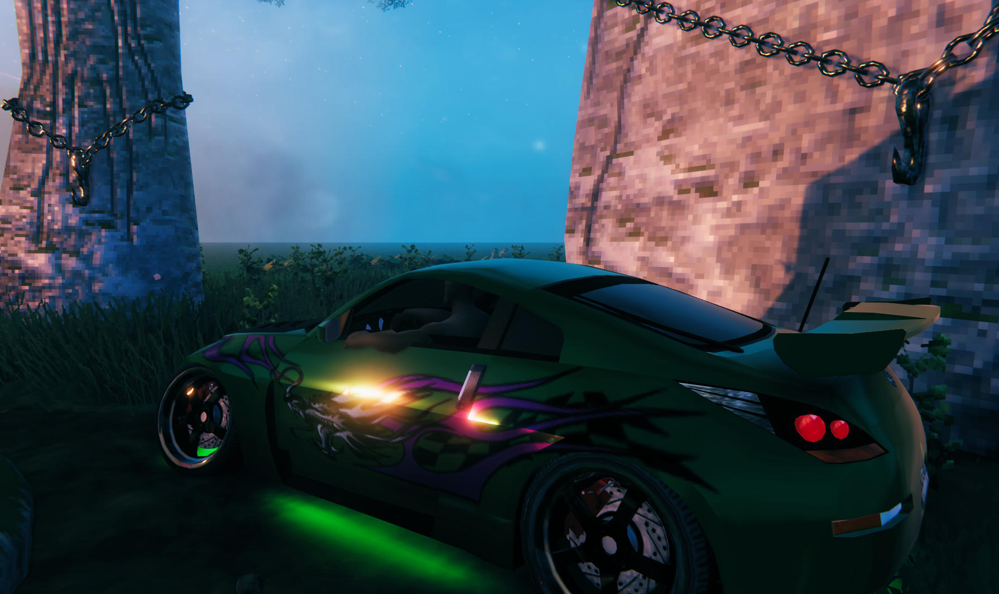
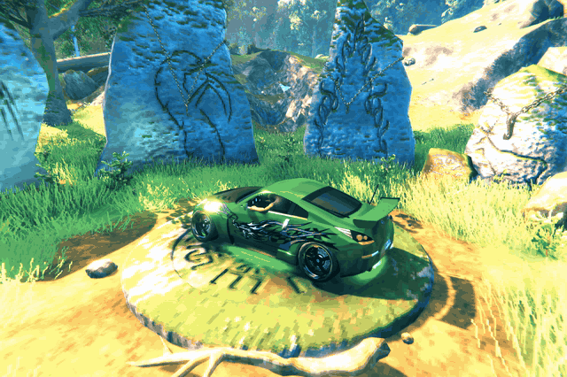

Drive a Nissan 350Z through Valheim. Drift through the meadows, hit the nitro,
or take off and fly. Viking transportation got a little out of hand.

*Is it random? — Yes. Is it useful? — Not really. Did I make it anyway? — Kinda. Codex did all of it.*

### What you get

- Nissan 350Z and Hummer H2, with road, off-road and flight modes; drift mode for the 350Z.
- Experimental 350Z Transformer: walk, sprint, crush trees and fire a shoulder-mounted Rust minigun.
- Nitro, neon, wheel and exhaust tuning, vehicle sounds, radio and a 350Z roof turret.
- Horde mode, cargo storage, controller support and English/German menus.

### Install & drive

Windows 10/11, 64-bit. **Single-player only**; cars and cargo are saved with the world.

Remove cars through **F9 → Vehicle → Remove vehicle**.

**[Download the Windows installer (ZIP)](https://github.com/Backwoodz/NFVU2/releases/download/v0.32.0/NFVU2-Setup-0.32.0.zip)** — v0.32.0, 157 MiB

1. Download and **extract the ZIP**, close Valheim, then run **NFVU2-Setup-0.32.0.exe** and select **valheim.exe**.
2. Click **Install / Update**. Music is included; BepInEx is installed if needed.
3. Launch Valheim, enter a single-player world and press **F9 / L3 → Garage** to spawn a car.

**E / B (Xbox) / Circle (PlayStation)** enters or exits a car.
E keeps normal world interactions when aiming at a door, chest or other object;
F7 remains available as an alternative vehicle key.

While boarded and stopped in a grounded 350Z, **F10 / RB / R1** transforms it
into a robot and back. Robot movement uses **WASD / left stick**, sprint uses
**Shift / X / Square**, and **left mouse / LB / L1** fires the minigun after spin-up.
Open **F9 / L3** while the robot is stationary to change ammunition or laser settings.
Existing configurations with `[TransformerPrototype] Enabled = false` keep the
feature disabled; set it to `true` with the game closed to enable it after updating.

Drive with **WASD** or the **left stick + triggers**. On-screen hints show the rest.
Customization and language settings are in **F9 / L3**.

Hold **W+S** or **RT+LT / R2+L2**
near standstill for a front-held burnout. **Space / A / Cross** remains the
rear handbrake. Drift countersteering now fades in with speed so slow donut
entries retain direct steering.

To update or uninstall, run the installer again and select the same game.
Installer 0.31.2 and newer download and verify ZIP updates automatically.
Older installers can update through the identical compatibility EXE provided with
each release. You can also download and extract the latest ZIP from
[Releases](https://github.com/Backwoodz/NFVU2/releases/latest).
The ZIP contains the Windows setup EXE; it is not a manual-install mod package.

### Gameplay

  
  

*350Z model previews rendered in Blender. In-game lighting and appearance differ.*

Experimental fan mod with its own driving physics.

Version 0.32.0 includes a separate `NFVU2.DriftPhysics.dll` for
350Z drift mode, with its own drivetrain and tyre model. It ships beside
`Rachel350Z.dll` through the normal build; no original racing-game library or
installation is required. The replacement passes core, adapter and actual
Unity/PhysX checks, including separate-library loading; personal in-game
handling acceptance remains open. See [local drift development](docs/DRIFT_WORLD.md).

Version 0.32.0 also replaces fixed-rate tyre smoke with wheel-following
wisps, friction/heat-driven density and a detached, wind-driven trail using
Valheim's lit smoke atlas. See [tyre smoke development and checks](docs/TYRE_SMOKE.md);
final in-game visual and performance acceptance remains open.

Create a world with the seed **drift** for parking arrival in a seated 350Z, endless
practice on the existing circuit, and a glowing event area for a separate
three-lap **Parkade Drift 1** race. Its 503 m route and gradual 7.1 m elevation
change were measured from the locally available original game data; the venue
uses Valheim terrain and building pieces. The event menu shows the route and its
separate high score. In-game driving, saved-world terrain, seated arrival and
stability acceptance are still pending; see [drift-world development](docs/DRIFT_WORLD.md).

[Releases](https://github.com/Backwoodz/NFVU2/releases) · [Changelog](CHANGELOG.md) · [Contributing](CONTRIBUTING.md) · [Known limitations](docs/ROADMAP.md)
