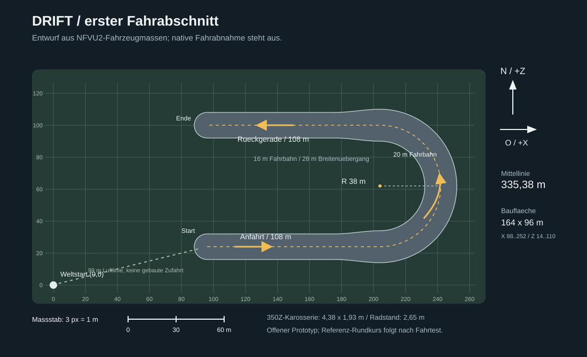

# Driftstrecke: erster Fahrabschnitt

Die Grundwelt mit Seed `drift` ist vom Nutzer im Spiel bestaetigt. Dieser
Entwurf fuegt zuerst einen offenen U-Abschnitt hinzu: Anfahrt, eine weite
180-Grad-Kurve und Rueckgerade. Das Referenzfoto liefert die Idee einer langen
Geraden und grossen Kehre. Der Prototyp bildet noch nicht dessen kompletten
Rundkurs oder die verschachtelten S-Kurven nach.

## Massstab aus dem vorhandenen 350Z

Die Masse beziehen sich auf NFVU2s aktuelles Fahrzeug, nicht auf angenommene
Seriendaten. Stand: Quellcode und lokale Modelldaten vom 18.10.2026.

| Groesse | Bestehender Wert | Quelle |
| --- | --- | --- |
| Karosseriebreite | 1,926 m | `.local/model/body.json`, Bounds der normalen `body`-Meshes ohne `optionGroup` |
| Karosserielaenge | 4,376 m | dieselben Mesh-Bounds, Z von -2,161 bis +2,214 m |
| Karosseriehoehe | 1,222 m | dieselben Mesh-Bounds; keine absolute Dachhoehe ueber Terrain |
| Fahrwerksradstand | 2,65 m | `VehicleSpawning.cs`: Vorderachse +1,30 m, Hinterachse -1,35 m |
| Fahrwerksspur | 1,60 m | Radmittelpunkte bei X +/-0,80 m |
| Radkolliderradius | 0,34 m | `VehicleSpawning.cs` |
| Karosseriekollider | 1,62 x 0,80 x 3,80 m | bewusst kuerzere/hoehere Box fuer kleine Hindernisse |
| Masse | 1450 kg | `VehicleSpawning.cs` |

Geoeffnete Tueren, Spiegelanbauten, geaenderte Radpositionen und Roboterform
sind keine Grundlage fuer die Fahrbahnbemessung. Bei 45 Grad Schraegstellung
beansprucht ein Rechteck aus den Karosseriemassen rund 4,46 m quer zur
Fahrtrichtung; nahe 90 Grad sind es rund 4,38 m. Die 16- bis 20-m-Fahrbahn
laesst damit bewusst Platz fuer Driftlinie und Korrekturen.

Das vorhandene Handling bleibt unveraendert. `VehicleDriftTuning.cs` gibt
45 Grad Lenkwinkel im Stand bis 22 Grad bei 32 m/s vor. Der vorhandene
Strassenantrieb reduziert sein Motormoment bis 34 m/s; dies ist keine
Fahrgeschwindigkeitsgarantie. Driftmodus nutzt Hinterradantrieb und geringere
seitliche Hinterachssteifigkeit. Aus diesen Parametern allein laesst sich
kein sicher fahrbarer Driftkurvenradius oder Bremsweg ableiten.

## Geometrie

Welteinheiten sind Meter. +X bedeutet Osten, +Z Norden; Y kommt getrennt
aus der Driftwelt-Grundhoehe 32 m. Die Fahrtrichtung fuehrt zuerst nach Osten,
dann links herum nach Westen.

| Abschnitt | Mittellinie | Laenge | Fahrbahnbreite |
| --- | --- | --- | --- |
| Anfahrt | (96,24) nach (204,24) | 108 m | 16 m; letzte 28 m weich auf 20 m |
| Linke Kehre | Halbkreis um (204,62), Radius 38 m | 119,38 m | 20 m |
| Rueckgerade | (204,100) nach (96,100) | 108 m | erste 28 m weich auf 16 m |

Gesamtlaenge der Mittellinie: 335,38 m. In der Kehre liegen die inneren und
aeusseren Fahrbahnradien bei 28 und 48 m. Die Geraden treffen den Kreis ohne
Richtungsbruch; die Kruemmung wechselt dort von null auf 1/38 pro Meter.
Dies ist noch kein Klothoidenentwurf. Die breitere Fahrbahn geht mit einem
Smoothstep ueber, damit keine ploetzliche Verengung entsteht.

Die konservative Begrenzung einschliesslich runder Endkappen lautet
X=88 bis 252 m und Z=14 bis 110 m. Der Weltstart bei (0,0) bleibt frei.
Bis zum Anfang der Mittellinie sind es rund 99 m Luftlinie. Eine Zufahrt oder
Teleportfunktion gehoert nicht zum Geometriemodell.

Fuer die erste Fahrt sind 35 bis 60 km/h als vorsichtiger Suchbereich sinnvoll;
das ist ein Vorschlag zur nativen Erprobung, keine bestandene Fahrabnahme.
Zuerst durchrollen und Fahrbahnuebergaenge pruefen, dann Driftlinie und
Kurvenbreite testen. Eine spaetere engere Kurve soll erst nach diesen Fahrten
festgelegt werden. Bei 50 km/h erfordert die 38-m-Mittellinie rein geometrisch
rund 5,08 m/s² Querbeschleunigung; das sagt noch nichts ueber Valheims
WheelCollider-Reaktion im Drift aus.

## Schnittstelle fuer den Streckenbauer

`src/DriftTrackLayout.cs` enthaelt ausschliesslich skalare Geometrie ohne Unity:

- `Samples`: 337 feste Punkte mit hoechstens einem Meter Abstand, jeweils mit
  Position X/Z, normierter Tangente, Weglaenge und `HalfWidth`.
- `AtDistance(distance)`: analytische Position und Tangente; endliche
  Weglaengen werden auf Anfang/Ende begrenzt.
- `WidthAt(distance)`: volle Fahrbahnbreite mit 28-m-Uebergaengen.
- `Project(x,z)`: naechster Punkt auf der Abtast-Polylinie, Abstand zur
  Mittellinie und `SignedEdgeDistance`; negativ innerhalb der lokalen Breite.
- `Contains`, `DistanceToCenterline`, `Bounds`: Masken- und Bereichsabfragen.

Die Kreisnaeherung der Projektion weicht maximal etwa 3,3 mm von der
analytischen Mittellinie ab. Der seitliche Maskenabstand ist Mittellinienabstand
minus lokale halbe Breite, kein exakter Abstand zur gekruemmten
variablen Fahrbahnkante. Positive `Contains`-Margin erweitert die Maske.
Nicht endliche Koordinaten, Weglaengen oder Margins werden abgewiesen.
Die beiden Sackgassenenden haben in der Maske runde Endkappen.

Layoutdaten erzeugen selbst weder Boden noch ZDOs und enthalten keine
Speicher-/Netzwerklogik. Der native Terrain-/Bauteiladapter ist fuer die
tatsaechliche Oberflaeche, Besitz-/Speicherverhalten und Valheim-Bauteile
zustaendig. Der reale Fahrtest mit dem 350Z steht aus.
